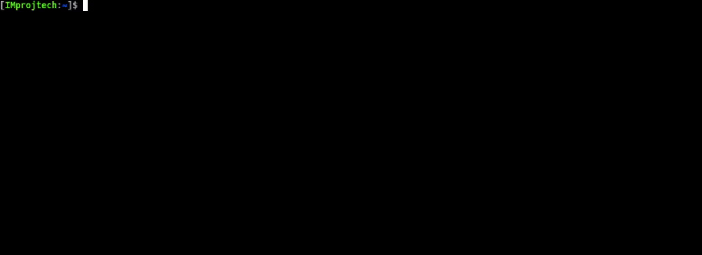
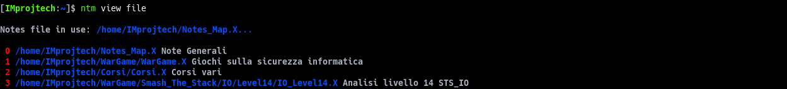
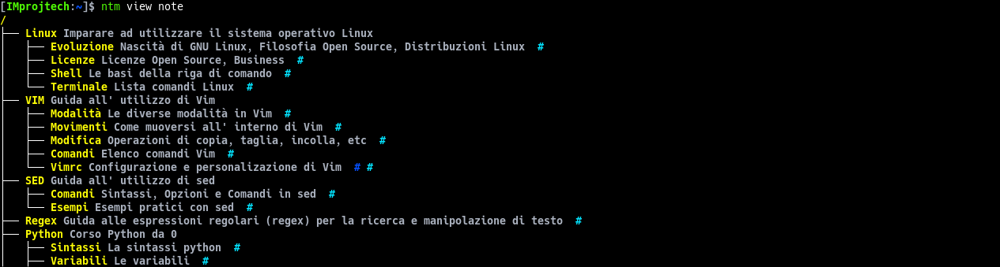
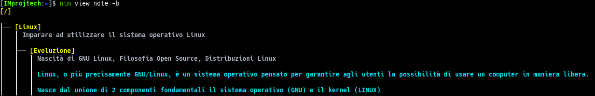

| 🇬🇧 Inglese | 🇮🇹  [Italiano](docs/it/README.md) |
|-----------|----------|

---

# 🧠 NotaMy



NotaMy is a hierarchical terminal-based technical note manager designed to reduce the mental cost of context switching for those working on long-term analysis tasks (pentesting, reverse engineering, wargames).

---

## 🎯 Why NotaMy Was Created

When I started working on pentesting activities and binary analysis, I quickly realized something:

**The problem is not taking notes — it's managing them over time.**

An analysis can last days or months. During that time, you accumulate memory addresses, test outputs, disassemblies, suspicious behaviors, failed attempts, ideas to verify — and all of this often ends up scattered across files and folders.

The result? Confusion. Continuously searching for information across scattered files interrupts mental flow and slows down the investigation.

**NotaMy was created to remove this friction**: reducing the cost of context switching while keeping all information shell-accessible, organized, and searchable.

---

## 🧩 What Is NotaMy

NotaMy is not a text editor.
It is not a markdown system.
It is not a graphical application.

It is a minimal, terminal-first system for organizing technical knowledge into note files (contexts) and hierarchical tree structures of nodes/tags.

### ⚙️ Key Features:

* Multiple note files (contexts) with fast context switching
* Hierarchical node structure with tags, comments, extended text, keywords, and file references
* Structured search (by tag, keyword, content)
* Fully keyboard-driven workflow
* Designed for long and complex technical workflows

---

## 🗂️ The Core Concept

Each note file represents a project or investigation. Switching files means switching mental space.

Example:

```bash
ntm view file
```



You can switch context with:

```bash
ntm setting 2
```

---

## 🌳 Hierarchical Structure

Notes are organized as nodes in a tree. Each node can contain:

* Tag (main keyword)
* Comment (visible post-it in the tree)
* Long text body
* File references
* Keywords for search

You can store a post-it or an entire book. All in the same place.

Example:

```bash
ntm view note
```



**#** indicates that the note contains expandable text.

You can expand each node to view its content:

```bash
ntm view note -b
```



---

## 🔄 Workflow (How I Use It)

* I create or select the note file (context).
* I add a node with tag and comment:

```bash
ntm add note -t "TAG" -c "Short comment"
```

* If needed, I write a longer text using the configured editor (vim by default):

```bash
ntm add note -t "TAG" -c "Comment" -b
```

The editor opens, I save and exit, and the body is inserted into the note.

* I link files (exploit, binary, config) directly to the note and use keywords to quickly retrieve everything.

---

## 👤 Who It’s For

NotaMy is designed for those who:

* live in the terminal
* work on long and complex technical tasks
* manage multiple projects simultaneously
* want structure without graphical interfaces
* prefer keyboard over mouse

---

## 🚫 Who It’s NOT For

It’s probably not for you if:

* you want cloud synchronization
* you need multi-user collaboration
* you want a modern graphical interface
* you want to write markdown documents

NotaMy is minimal and focused.

---

## 📝 Brief History

NotaMy was born from a personal need:

To reduce the mental cost of context switching.

Notes are not the problem. Complexity is.

In 2020, I started with a basic version called "Note Management": simple structured text.
It was already useful. Then came MemoKeeper and MemoKeeperX, with separate files and tags.
Over time, it became part of my daily workflow: pentesting, studying, ideas, and small projects.

NotaMy is the mature version of that workflow: minimal, reliable, and adapted to the way I work.

> Want to know why and how NotaMy was born? Read the project's [PHILOSOPHY](docs/en/philosophy.md).

---

## 🚀 Installation

```bash
git clone https://github.com/IMprojtech/NotaMy.git
cd NotaMy
make
./bin/ntm
```

### Add `NotaMy` to Your PATH

After compiling `ntm`, you may want to run it from anywhere without typing the full path. Here’s a common approach:

### Install in a Directory Already in Your PATH

1. Copy or move the compiled binary to a standard location, for example:

```bash
sudo cp ./bin/ntm /usr/local/bin/
sudo cp ./bin/ntm_nc /usr/local/bin/
```

Or, if you prefer a local installation (without `sudo`):

```bash
mkdir -p "$HOME/.local/bin"
cp ./bin/ntm "$HOME/.local/bin/"
cp ./bin/ntm_nc "$HOME/.local/bin/"
```

Make sure that directory is in your `PATH`. Most Linux distributions include `/usr/local/bin` by default. If you used `~/.local/bin`, ensure your shell initialization file adds it to the `PATH`. For example, in `~/.bashrc` or `~/.zshrc`:

```bash
# Add this if not already present:
export PATH="$HOME/.local/bin:$PATH"
```

Alternatively, you can directly add the `bin` directory to your shell initialization file:

```bash
export PATH="$HOME/path/to/NotaMy/bin:$PATH"
```

---

## 🐚 Optional Zsh Integration

NotaMy provides an optional Zsh wrapper that enhances the user experience without modifying the core C program.

The wrapper adds:

* Wrapped `ntm` command with improved output handling
* Automatic pagination via `bat`
* Proper TTY detection
* `fview` function for interactive note viewing (fzf + bat)
* `nocolor` function to remove ANSI escape sequences
* Temporary note file switching via numeric prefix

### Temporary Note File Switching

The wrapper allows you to temporarily switch the active file by placing its number before the command:

```bash
ntm 1 view note
```

### Installation

Add the plugin file to your `~/.zshrc`:

```bash
source /path/to/NotaMy/shell/zsh/notamy.plugin.zsh
```

Then reload your shell:

```bash
source ~/.zshrc
```

> ⚠️ Zsh integration is completely optional.
> The core C application works independently.

---

## 📘 Documentation

A complete user manual is available with installation instructions, usage examples, and all supported commands:

📄 [Read the NotaMy Manual](docs/en/manual.md)

---

## ⚖️ License

This program is distributed under the terms of the GNU General Public License (GPL), ensuring the freedom to redistribute and modify the software according to free software standards.

---

## ✍️ Author

Written by Catoni Mirko (`IMprojtech`)

---
